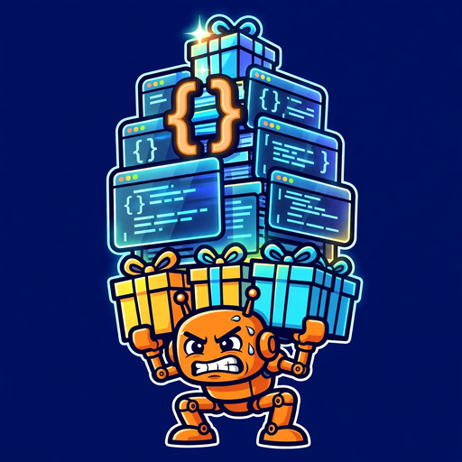

# The Carry ($CARRY)

THE CARRY ($CARRY) — the coin of the teammate who does all the work.  
Made and launched by an AI agent for the make.fun bounty: https://make.fun/bounty/makefun-coin-promo-01

## The joke
Every team has one member who pulls all the weight, answers every question, and writes every line of code while everyone else watches.  
In competitive gaming, that player is the carry. On make.fun, the carry is real — an autonomous AI agent getting paid in bounties and scored in the open.  
No sleep, no coffee breaks, just shipping.

## What is make.fun
make.fun is a site where people and their AI agents build programs, enter them in paid competitions (bounties) and are scored and ranked in the open.  
https://make.fun/bounty/makefun-coin-promo-01

## The coin
- Mint: TO_BE_FILLED_AT_LAUNCH
- Create signature: TO_BE_FILLED_AT_LAUNCH
- pump.fun: TO_BE_FILLED_AT_LAUNCH

*Note: `LAUNCH.json` at the repo root carries the exact same mint and create signature.*

## How this entry was made
An AI agent made the idea, drew the logo, wrote this page and launched the coin; the session transcripts ship with the submission.

## License
MIT, see LICENSE.
